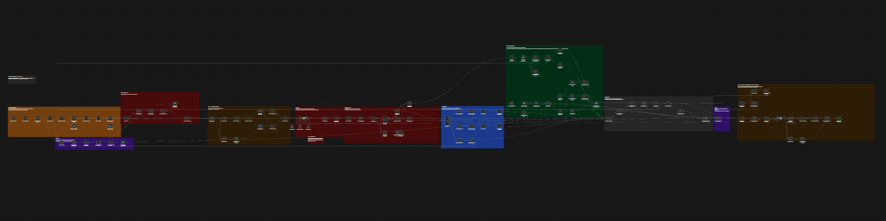
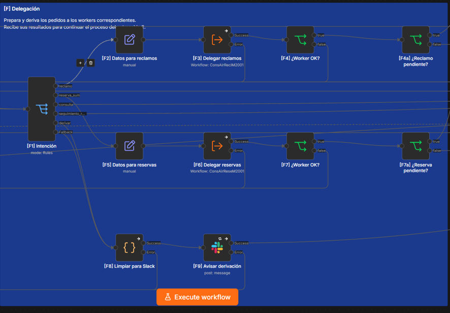
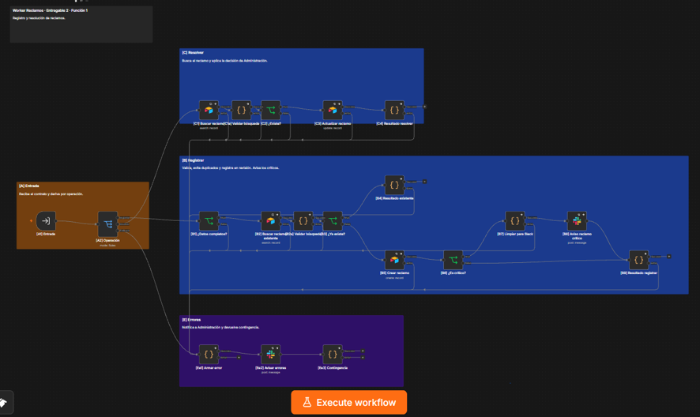
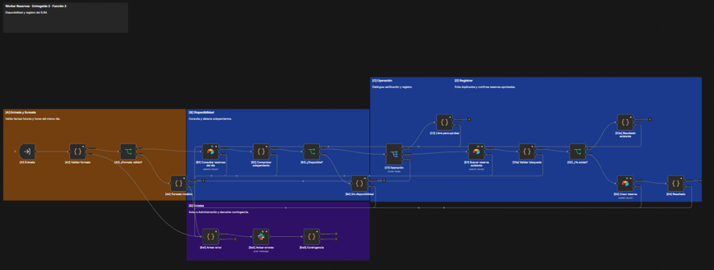
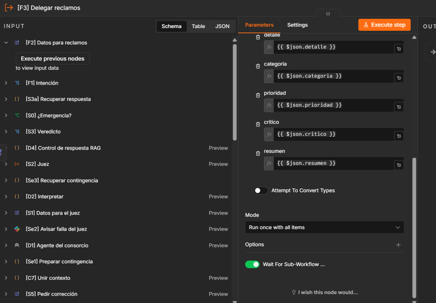
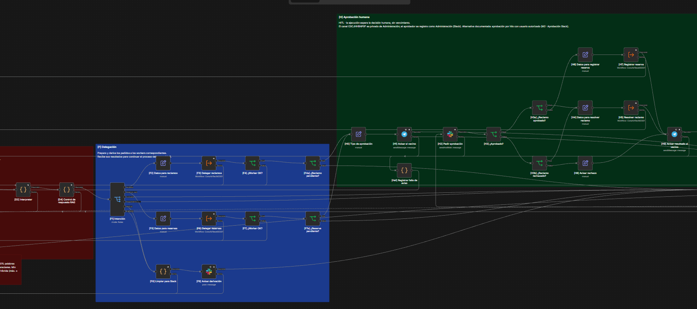
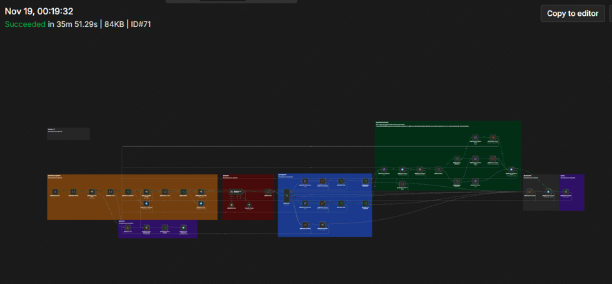
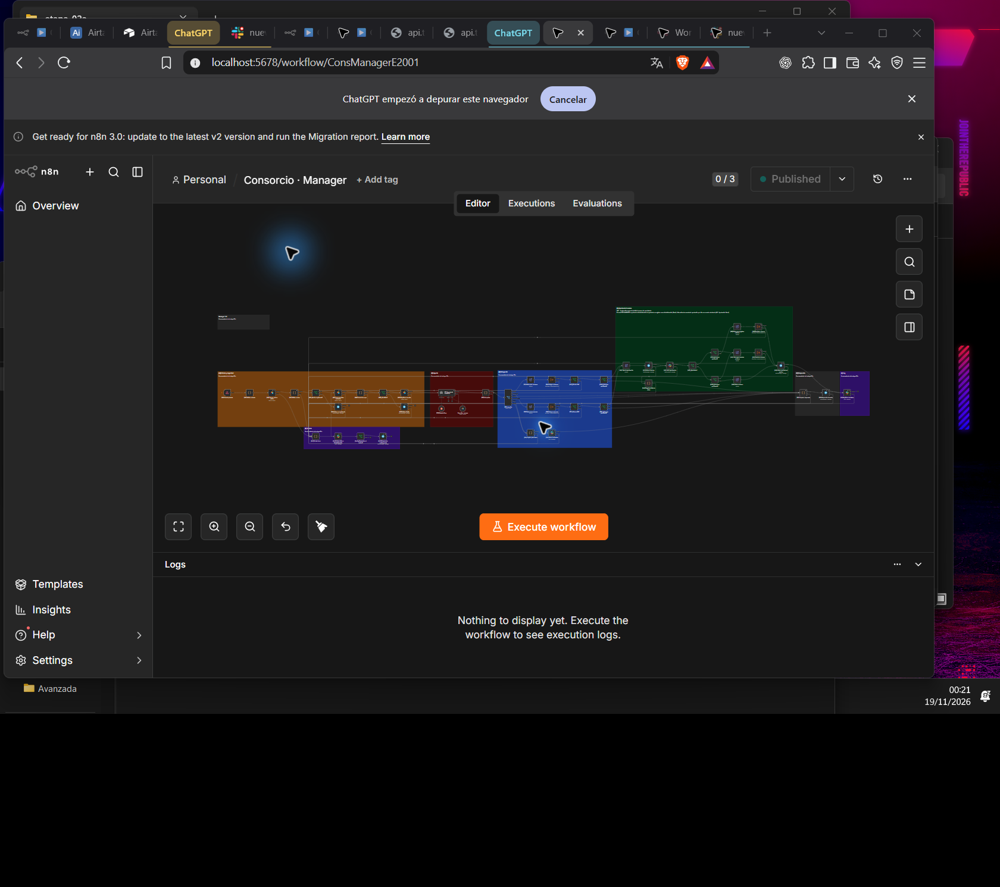

# Entregable 2 · Manager, workers y aprobación humana

El agente pasa a ser un **Manager** que clasifica la intención del vecino y delega en dos sub-workflows (workers): **reclamos** y **reservas del SUM**. Cada pedido queda pendiente hasta que una persona lo aprueba o rechaza en Slack con "Send and Wait", **sin límite de tiempo**. Todos los workers devuelven el mismo contrato: `{status, worker, traceId, data}`.

## Archivos

- `PreEntrega_Modulo2_Alexis_Vazquez.pdf`: documento entregado.
- `workflows/`: Manager y los dos workers (anonimizados).
- `capturas/`: lienzos, delegación y ejecuciones.

## Pruebas

| Ejecución | Caso | Resultado |
|---|---|---|
| 55 | Reclamo aprobado en Slack | Registrado y aviso al vecino |
| 60, 66 | Reclamo y reserva | Clasificación y delegación correctas |
| 70 | Falla del worker de reclamos | Carril de error: aviso a Slack y contingencia |
| 71 | Reserva que esperó 35 minutos la aprobación | Registrada al aprobarse, sin vencimiento |

## Workflows

- [consorcio_reclamos.json](workflows/consorcio_reclamos.json)
- [consorcio_reservas.json](workflows/consorcio_reservas.json)
- [Manager completo](../final/workflows/consorcio_manager.json).

## Capturas

**Lienzo completo del Manager**, con los bloques ordenados por proceso:

**Bloque [F] Delegación:** el Switch `[F1] Intención` y los Execute Workflow `[F3] Delegar reclamos` y `[F6] Delegar reservas`.

**Worker de reclamos:** entrada [A], registrar [B], resolver [C] y carril de errores [E].

**Worker de reservas:** validación de formato, disponibilidad, operación, registro y errores.

**Nodo `[F3] Delegar reclamos`:** solo los campos necesarios y Wait For Sub-Workflow Completion activado.

**Bloques [F] y [H]:** aprobación humana en Slack sin vencimiento y nueva llamada al worker según la decisión.

**Ejecución 71:** terminó con éxito después de 35 minutos y 51 segundos esperando la aprobación.

**Versión del Manager al cierre de la etapa 02.**

