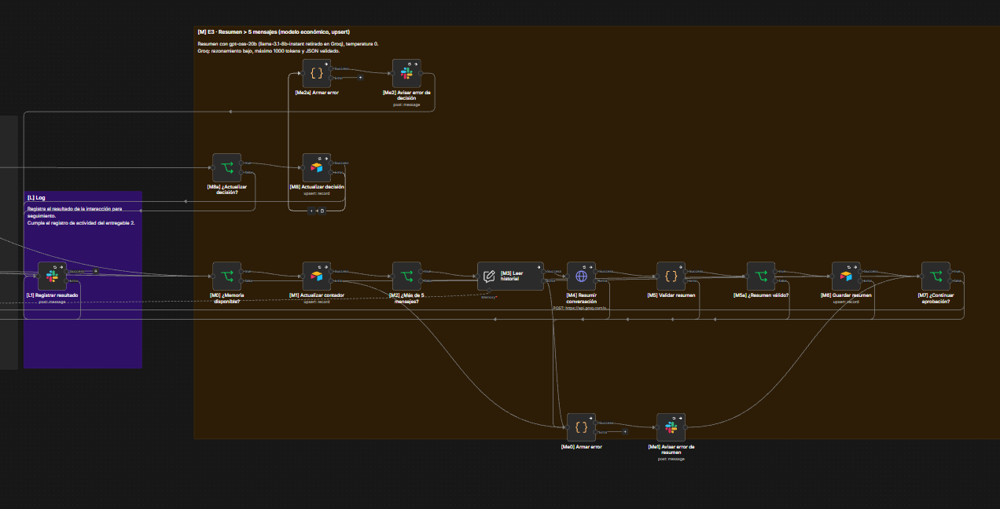
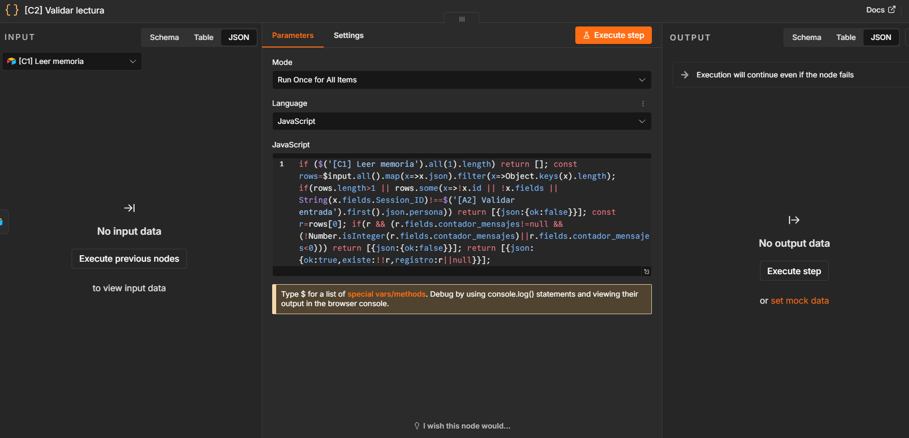
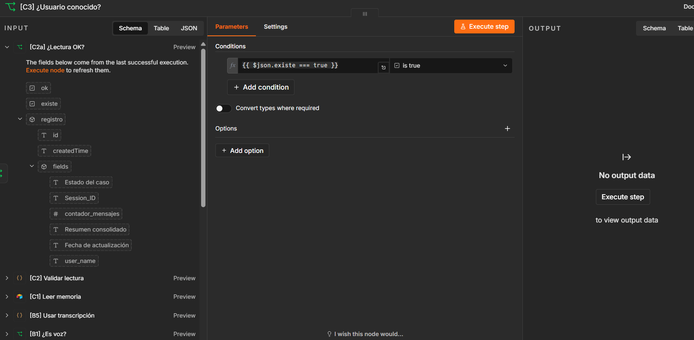

# Entregable 3 · Memoria en Airtable y resumen

El Manager recuerda a cada vecino entre conversaciones. La memoria vive en Airtable, identificada por su chat de Telegram (`Session_ID`), y se inyecta en el prompt como un bloque de contexto delimitado que el agente trata como información, no como instrucciones. Cuando una conversación supera los 5 mensajes, un modelo la resume en un JSON validado con JSON Schema y se guarda el resumen.

## Archivos

- `PreEntrega_Modulo3_Alexis_Vazquez.pdf`: documento entregado.
- `workflows/`: Manager con el bloque de memoria (anonimizado).
- `capturas/`: lienzo, tabla de memoria y resumen.

## Pruebas

| Ejecución | Caso | Resultado |
|---|---|---|
| 92 | Vecino nuevo | Crea su fila de memoria |
| 93 | Vecino conocido | Recupera el contexto anterior |
| 98 | Más de 5 mensajes | Genera y guarda el resumen |
| 99 | Conversación posterior | Usa el resumen guardado |

## Workflows

- No hay archivos de workflow propios en esta carpeta.
- [Manager completo](../final/workflows/consorcio_manager.json).

## Capturas

-  — manager bloque M resumen.
-  — nodo C2 validar lectura.
-  — nodo C3 usuario conocido.
