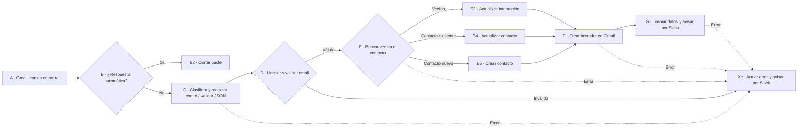
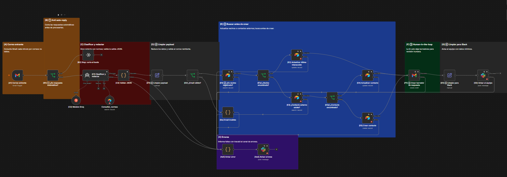
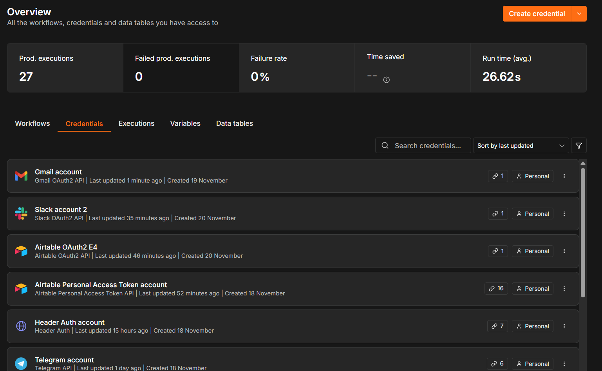
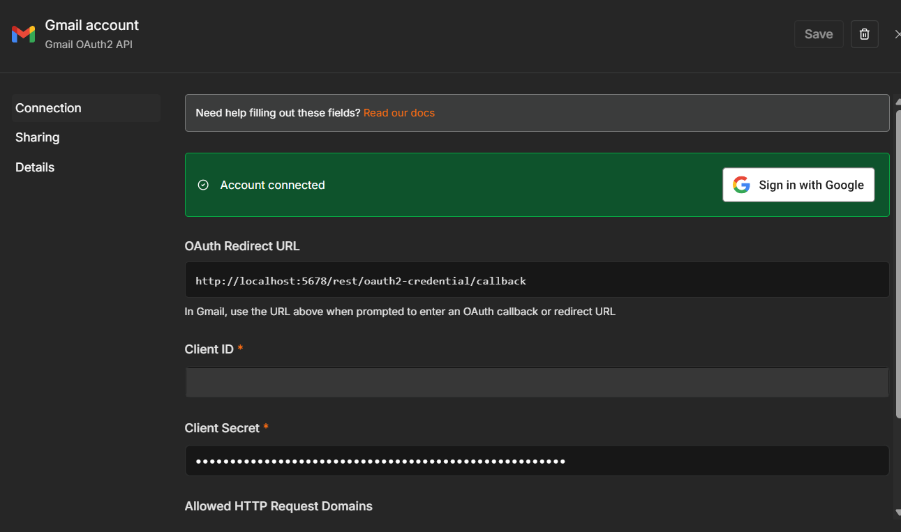
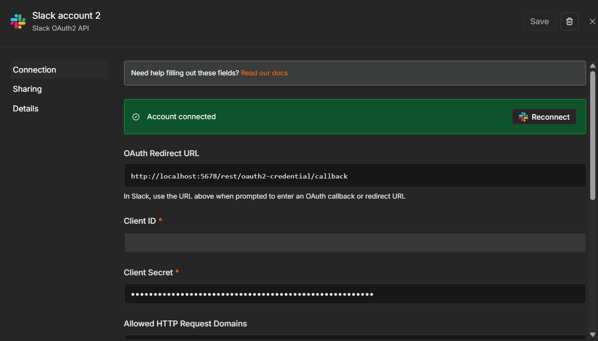
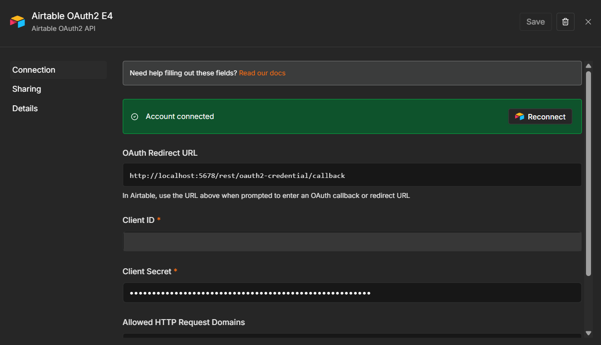
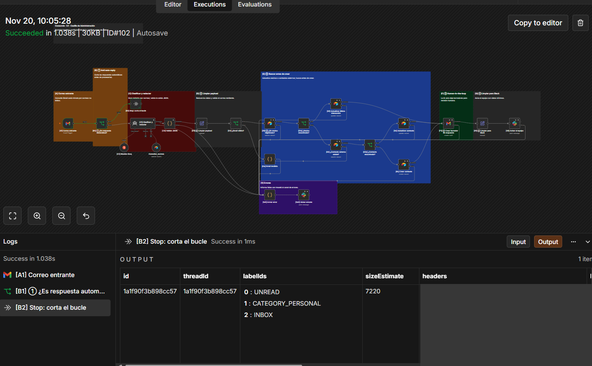
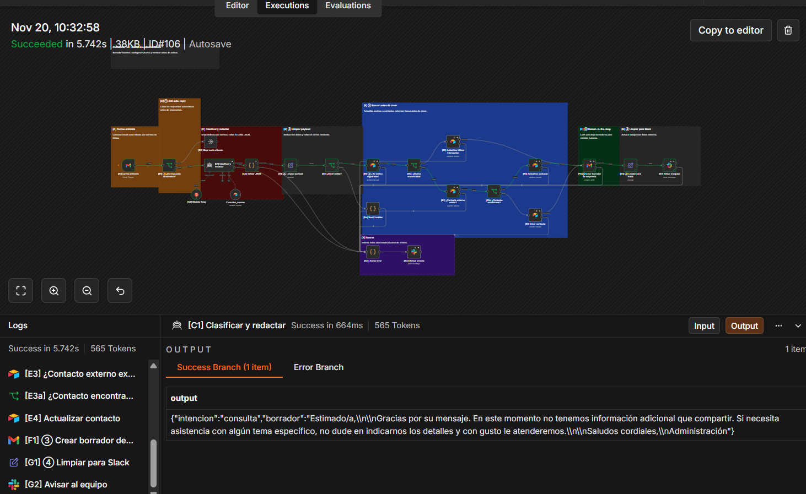

# Entregable 4 · Casilla de Administración

## Qué hace

La Casilla consulta el Gmail de Administración cada minuto y descarta respuestas automáticas para evitar bucles. Clasifica el correo con IA y busca al remitente en el CRM de Airtable. Actualiza el registro existente o crea un contacto externo, prepara un borrador de respuesta en Gmail y avisa al equipo por Slack. El correo nunca se envía automáticamente.

## Flujo

## Bloques

| Bloque | Nodos | Qué hace |
|---|---|---|
| A | [A1] Correo entrante | Consulta Gmail cada minuto. |
| B | [B1] ① ¿Es respuesta automática?; [B2] Stop: corta el bucle | Detiene respuestas automáticas. |
| C | [C1] Clasificar y redactar; [C2] Modelo Groq; Consultar_normas; [C3] Validar JSON | Clasifica y redacta, consulta normas y valida la salida. |
| D | [D1] ④ Limpiar payload; [D2] ¿Email válido?; [De] Email inválido | Prepara los datos y controla el remitente. |
| E | [E1] ② ¿Es vecino registrado?; [E1a] ¿Vecino encontrado?; [E2] Actualizar última interacción; [E3] ¿Contacto externo existe?; [E3a] ¿Contacto encontrado?; [E4] Actualizar contacto; [E5] Crear contacto | Busca al vecino o contacto y actualiza o crea el registro. |
| F | [F1] ③ Crear borrador de respuesta | Crea un borrador, sin enviarlo. |
| G | [G1] ④ Limpiar para Slack; [G2] Avisar al equipo | Prepara y envía el aviso interno. |
| Errores | [Xe1] Armar error; [Xe2] Avisar errores | Informa el error en Slack. |

## Credenciales OAuth2

- Gmail: `Gmail account`.
- Slack: `Slack account 2`.
- Airtable: `Airtable OAuth2 E4`.

El modelo también requiere la credencial `Groq account` de tipo Groq API. El nodo Gmail usa un conjunto fijo de permisos; esta instancia lo limita a `gmail.readonly` y `gmail.compose`, para leer y crear borradores. La app de Google está en modo Testing: la autorización vence a los 7 días; reconectala antes de la demo.

## Manejo de errores

Las escrituras tienen Retry On Fail y los nodos principales de servicio, agente y validación conectan su salida de error al carril [Xe1] → [Xe2], que avisa al canal de errores de Slack. El agente [C1] también reintenta porque gpt-oss a veces pide herramientas inexistentes. El aviso de errores continúa aunque falle Slack.

## Pruebas

| Ejecución | Resultado observado |
|---|---|
| 102 | Respuesta automática detectada y cortada en [B2]. |
| 105 | Remitente externo nuevo: [E5] crea contacto; se crea borrador y se avisa por Slack. |
| 106 | Contacto externo existente: [E4] actualiza sin crear otro; se crea borrador y se avisa por Slack. |
| 112 | Vecino registrado: [E2] actualiza la última interacción; se crea borrador y se avisa por Slack. |

## Cómo importarlo

1. Importá `checkpoint4_Alexis_Vazquez.json` en n8n.
2. Creá y conectá las credenciales OAuth2 con los nombres indicados y la credencial `Groq account`; asignalas a los nodos correspondientes.
3. Reemplazá los marcadores `appXXXXXXXXXXXXXX`, `tblXXXXXXXXXXXXXX`, `CXXXXXXXXXX` y cualquier otro marcador presente por tus propios valores. Seleccioná la base y la tabla correspondiente en cada nodo Airtable y revisá también la URL guardada de la herramienta de normas.
4. Revisá los permisos y conexiones; activá el workflow.

## Capturas

-  — Lienzo completo de la Casilla.
-  — Las tres credenciales OAuth2.
-  — Gmail con “Account connected”.
-  — Slack con “Account connected”.
-  — Airtable con “Account connected”.
-  — Corte de respuesta automática.
-  — Actualización del contacto sin duplicar.
-  — Borrador creado en Gmail.
-  — Aviso al equipo en Slack.

## Workflows

- [checkpoint4_Alexis_Vazquez.json](checkpoint4_Alexis_Vazquez.json)
