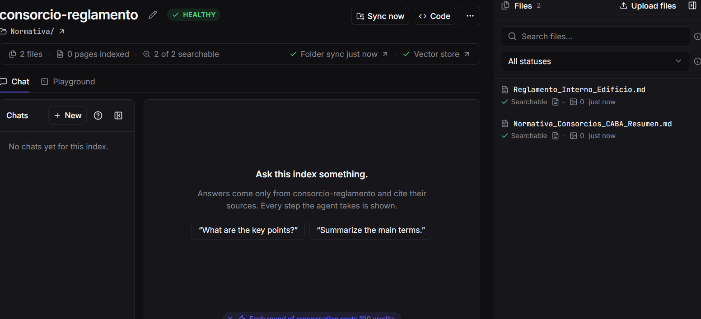
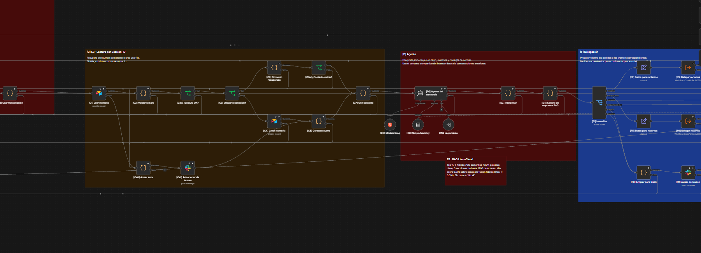
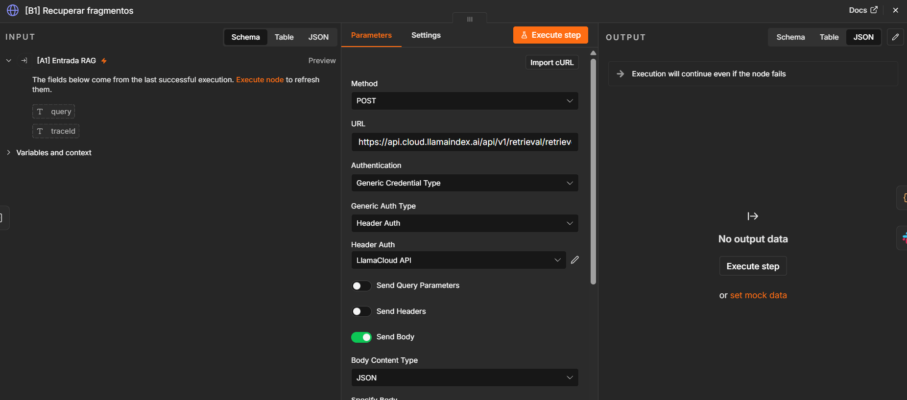
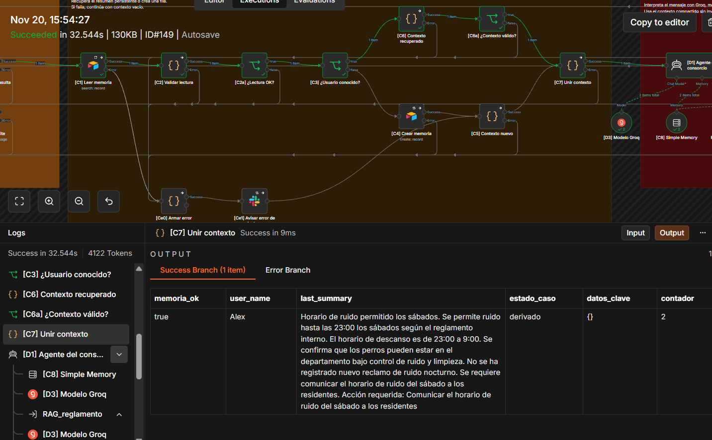
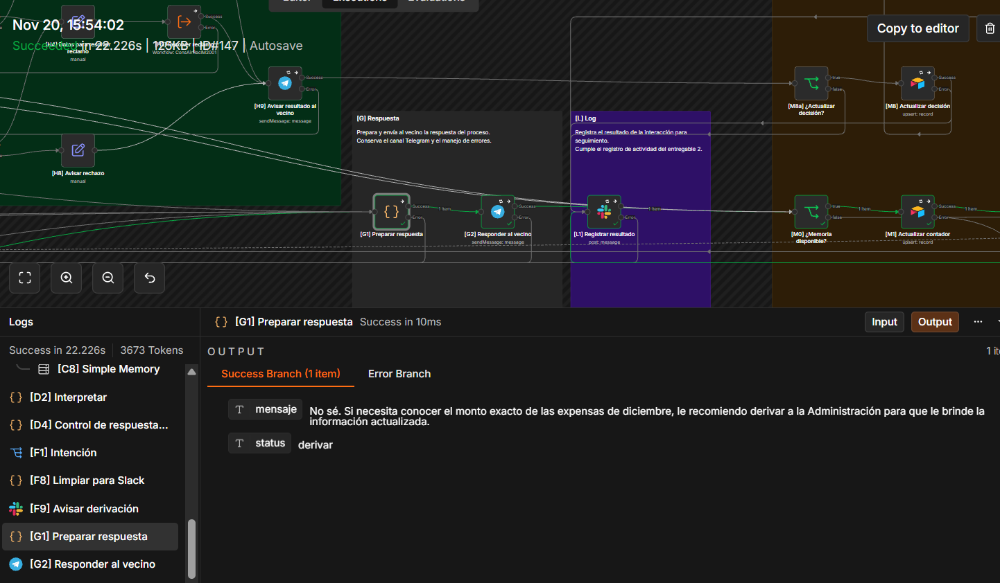

# Entregable 5 · RAG con LlamaCloud

El agente responde las consultas de convivencia solo con el reglamento interno y la normativa de consorcios de CABA, indexados en LlamaCloud. Usa una herramienta (`RAG_reglamento`) conectada por la conexión lateral del agente, cita el documento y el artículo, y responde "No sé." cuando el dato no está.

- Búsqueda híbrida (70 % vectorial, 30 % texto), **Top-K 4**, **Min Score 0.005** (los puntajes híbridos reales van de 0,011 a 0,016).
- Un nodo de control verifica el "No sé." literal y que la fuente citada corresponda al fragmento usado.

## Archivos

- `PreEntrega_Modulo5_Alexis_Vazquez.pdf`: documento entregado (incluye la tabla de 5 preguntas ciegas y el plan de gobernanza).
- `workflows/`: "Consorcio · Tool · RAG" y el Manager (anonimizados).
- `capturas/`: índice de LlamaCloud, herramienta y respuestas con fuente.

## Pruebas (5 preguntas ciegas)

| Ejecución | Pregunta | Veredicto |
|---|---|---|
| 149 | ¿Puedo tener un perro en el depto? | Correcta (Art. 11) |
| 139 | ¿Hasta qué hora se puede hacer ruido el sábado? | Correcta (Art. 3) |
| 141 | ¿Puedo dejar la bici en el palier? | Correcta (Art. 8) |
| 145 | ¿Qué pasa si el administrador no rinde cuentas? | Parcial; corregida en la 154 |
| 147 | ¿Cuánto sale la expensa de diciembre? (sin cobertura) | Correcta: "No sé." |

## Workflows

- [consorcio_tool_rag.json](workflows/consorcio_tool_rag.json)
- [Manager completo](../final/workflows/consorcio_manager.json).

## Capturas

**Índice en LlamaCloud:** estado HEALTHY, los dos documentos en estado Searchable y vector store activo.

**Agente con la herramienta RAG:** `[D1]` con el modelo, la memoria y `RAG_reglamento` conectados por las conexiones laterales; abajo, la nota con Top-K y Min Score.

**Nodo `[B1] Recuperar fragmentos`:** POST al endpoint de retrieval de LlamaCloud con la credencial Header Auth.

**Ejecución 149 (perro):** recorrido en verde desde la memoria hasta el agente, con la llamada a `RAG_reglamento` en el panel de logs.

**Ejecución 147 (expensa de diciembre, sin cobertura):** la respuesta empieza con "No sé." y ofrece derivar.

