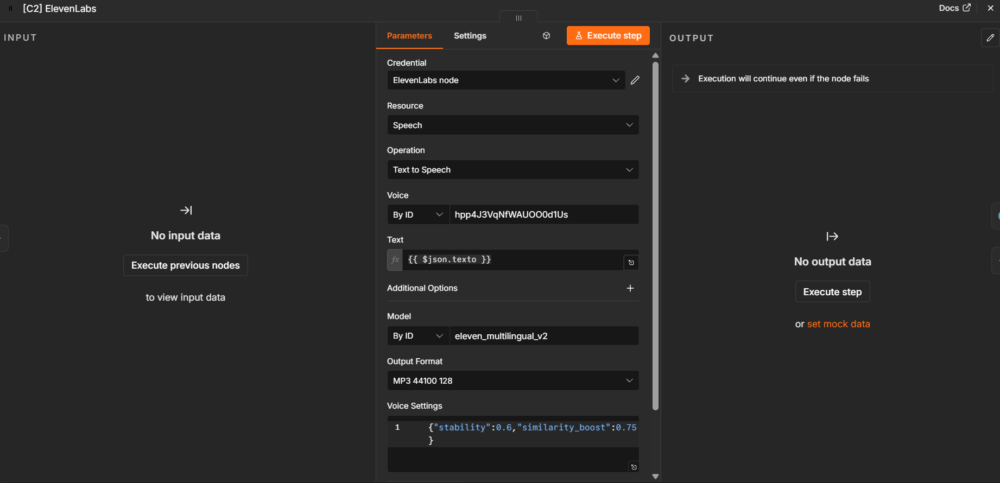
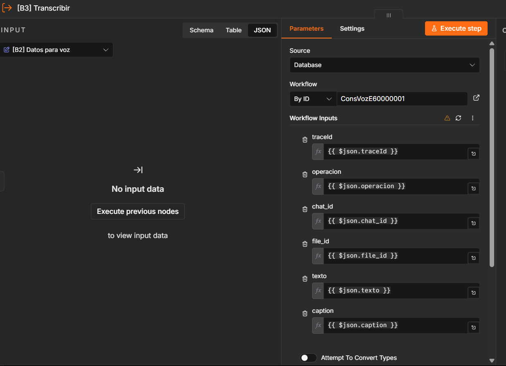
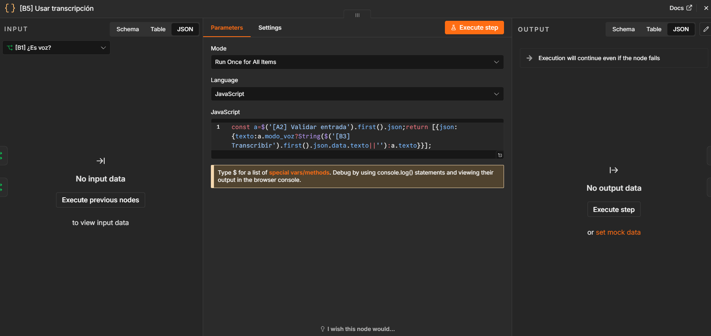
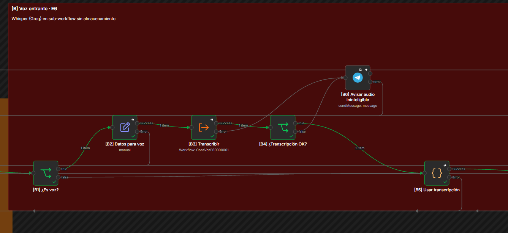
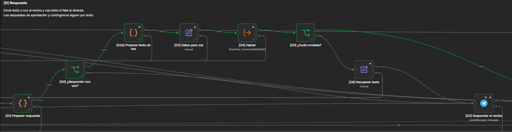
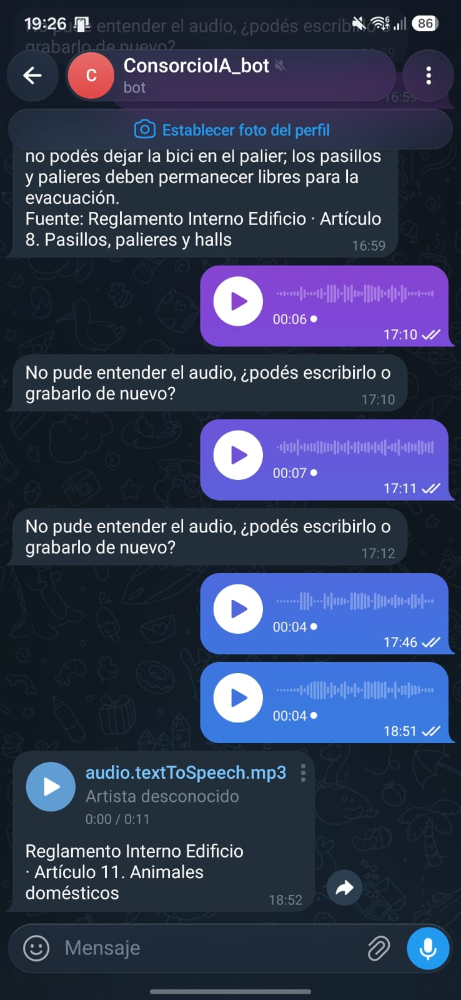
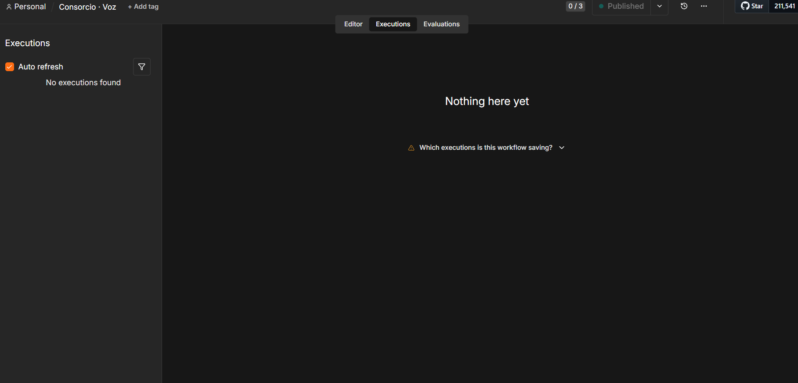
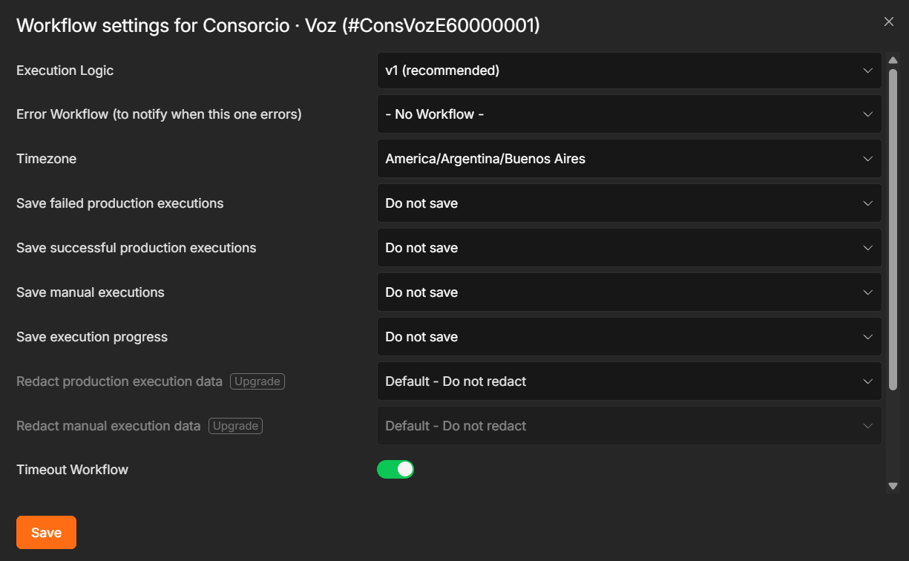
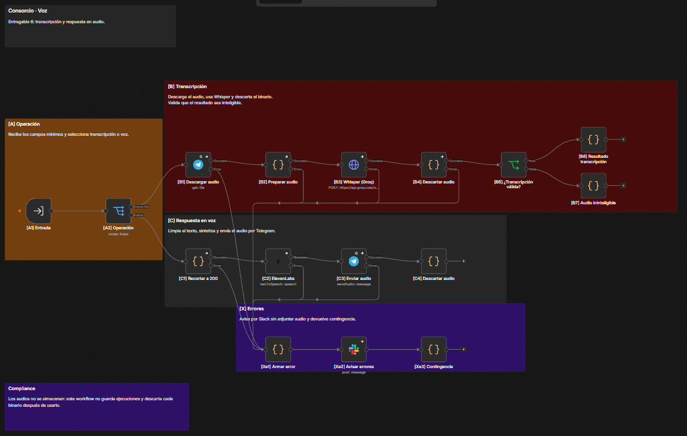
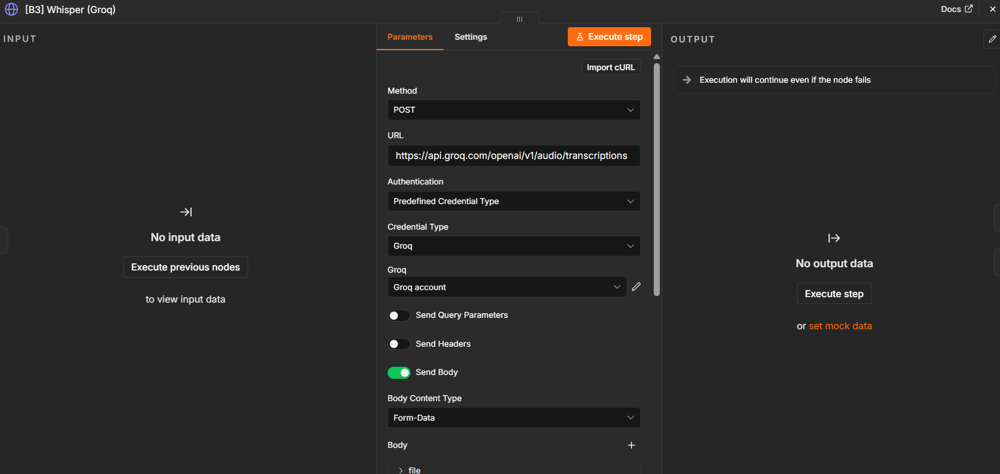

# Entregable 6 · Voz: Whisper + ElevenLabs

El vecino puede mandar notas de voz. Un sub-workflow, **Consorcio · Voz**, transcribe el audio con Whisper (`whisper-large-v3` en Groq) y, si el mensaje original fue de voz, responde en audio con ElevenLabs (`eleven_multilingual_v2`, máximo 200 caracteres). Si la voz falla, responde por texto.

**Compliance:** los audios no se almacenan. El sub-workflow de voz no guarda ninguna ejecución, n8n maneja los binarios en memoria y cada nodo descarta el archivo después de usarlo.

## Archivos

- `PreEntrega_Modulo6_Alexis_Vazquez.pdf`: documento entregado.
- `workflows/`: "Consorcio · Voz" y el Manager (anonimizados).
- `capturas/`: circuito, Whisper, ElevenLabs, settings sin guardado y Telegram.

## Pruebas

| Ejecución | Caso | Resultado |
|---|---|---|
| 172 | Nota de voz: perro | Transcripción correcta, respuesta en audio con el Art. 11 |
| 221 | Nota de voz: gato | Respuesta en audio con el Art. 11 |
| 167 | Audio en silencio | Rechazado; pide repetirlo por texto |
| 163 | Mensaje de texto | El camino de texto no cambió |
| 165 | Falla de descarga | Contingencia por texto |

## Workflows

- [consorcio_voz.json](workflows/consorcio_voz.json)
- [Manager completo](../final/workflows/consorcio_manager.json).

## Capturas

-  — elevenlabs nodo.
-  — manager B3 transcribir.
-  — manager B5 usar transcripcion.
-  — manager bloque B voz entrante.
-  — manager bloque G respuesta voz.
-  — telegram voz.
-  — voz ejecuciones vacias.
-  — voz settings sin guardado.
-  — voz workflow.
-  — whisper nodo.
