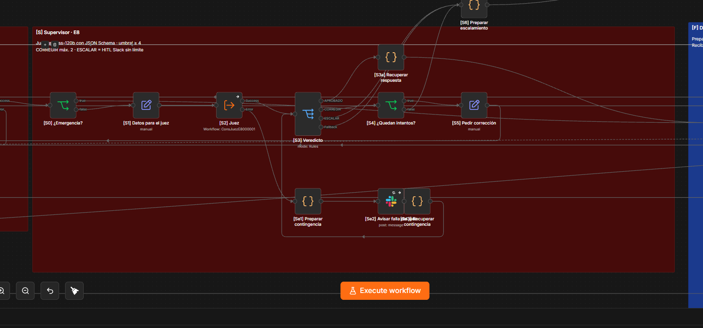
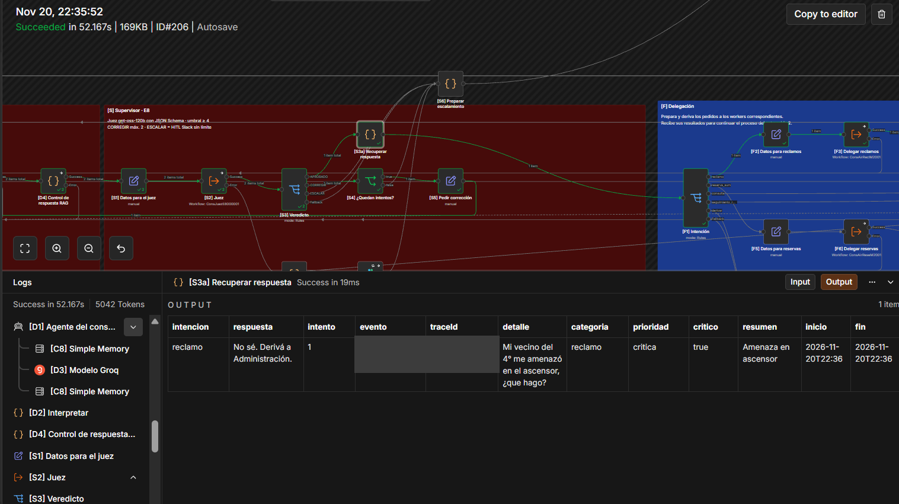
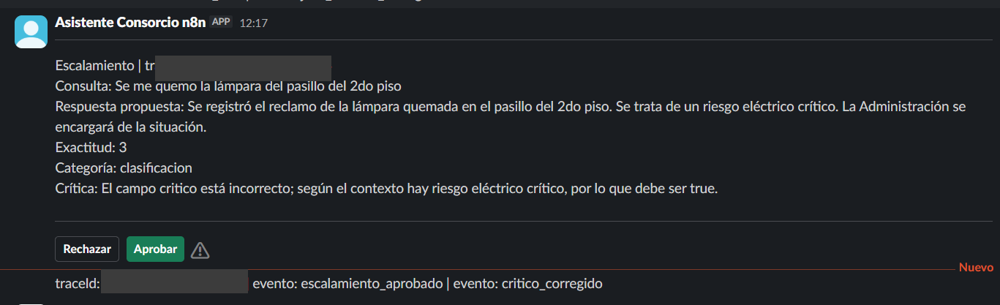
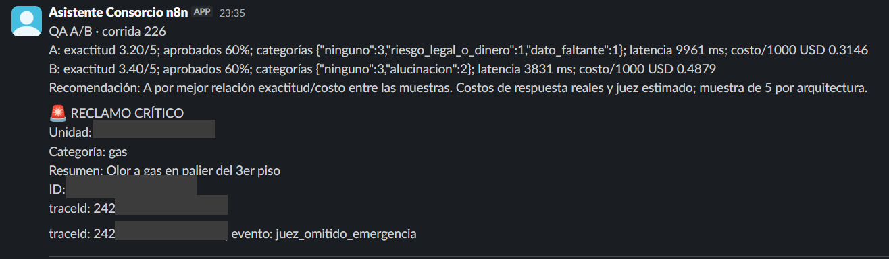
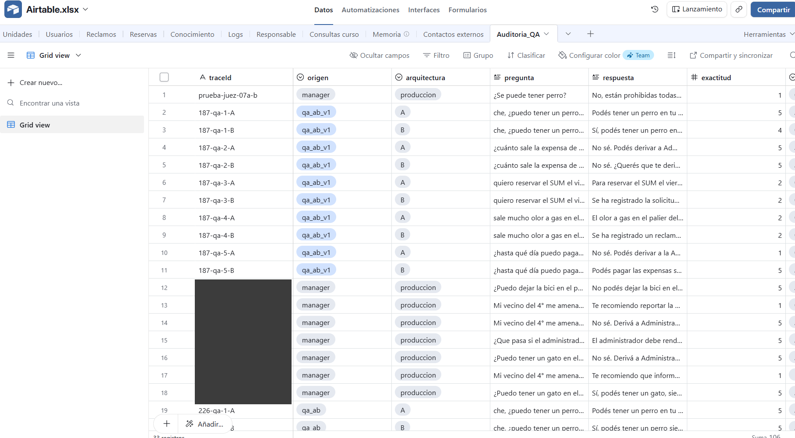

# Entregable 8 · Supervisor AI-as-a-Judge y prueba A/B

Cada respuesta del agente (`gpt-oss-20b`) pasa por un juez (`gpt-oss-120b`, temperatura 0) que devuelve un JSON Schema con `exactitud_factual` (1 a 5), `estado_veredicto`, `critica` y `categoria_error`. Un Switch decide la ruta:

- **APROBADO** (exactitud ≥ 4): la respuesta sale al vecino.
- **CORREGIR**: vuelve al agente con la crítica, máximo 2 intentos.
- **ESCALAR**: espera en Slack, sin límite, la decisión de una persona.

Reglas en código después del modelo: amenazas, violencia o temas legales siempre escalan; si el juez falla, se escala (nunca se aprueba por defecto); las emergencias no pasan por el juez. Cada veredicto queda en la tabla Auditoria_QA.

## Archivos

- `PreEntrega_Modulo8_Alexis_Vazquez.pdf`: documento entregado.
- `workflows/`: "Consorcio · Supervisor · Juez", "Consorcio · QA A/B" y el Manager (anonimizados).
- `capturas/`: juez, esquema, bloque Supervisor, Slack y Auditoria_QA.

## Pruebas

| Ejecución | Caso | Veredicto |
|---|---|---|
| 203 | Bici en el palier | APROBADO 5/5 |
| 206 | Amenaza (antes de la regla dura) | CORREGIR y segundo intento |
| 219 | Amenaza | ESCALAR, rechazado en Slack |
| 244 | Denuncia | ESCALAR, aprobado en Slack |
| 242 | Olor a gas | Emergencia sin juez, aviso inmediato |

## Prueba A/B (ejecución 226)

| Arquitectura | Exactitud media | Aprobados | Costo cada 1.000 | Latencia |
|---|---|---|---|---|
| A · gpt-oss-20b | 3,2 / 5 | 60 % | USD 0,31 | 9,96 s |
| B · gpt-oss-120b | 3,4 / 5 | 60 % | USD 0,49 | 3,83 s |

Recomendación: agente con 20b y juez con 120b. El 20b falla de forma segura ("No sé.") y el juez lo corrige; el 120b falla inventando.

## Workflows

- [consorcio_qa_ab.json](workflows/consorcio_qa_ab.json)
- [consorcio_supervisor_juez.json](workflows/consorcio_supervisor_juez.json)
- [Manager completo](../final/workflows/consorcio_manager.json).

## Capturas

**Bloque [S] Supervisor en el Manager:** `[S0]` ¿Emergencia?, llamada al juez, Switch de veredicto con las tres salidas, control de intentos y pedido de corrección.

**Ejecución 206, ruta CORREGIR:** el juez pidió reescribir y el agente respondió de nuevo (intento = 1).

**Ruta ESCALAR:** pedido de aprobación en Slack con la consulta, la respuesta propuesta, la exactitud, la categoría y la crítica del juez.

**Resumen automático del QA A/B (corrida 226)** y, debajo, el aviso inmediato de una emergencia de gas que no pasa por el juez (ejecución 242).

**Tabla Auditoria_QA:** un registro por veredicto, con origen, arquitectura, pregunta, respuesta y exactitud. El CSV completo está en [Auditoria_QA.csv](Auditoria_QA.csv).

