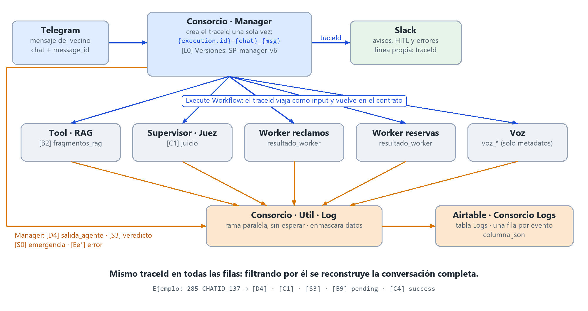

# Entregable 9 · Plan de gobernanza, gestión y monitoreo financiero de IA

Plan en tres dimensiones sobre el mismo bot de las entregas anteriores:

- **Finanzas:** 3 KPIs (resolución autónoma, horas ahorradas, satisfacción), ROI contra un baseline manual (25 h y USD 151 ahorrados por mes contra un TCO de unos USD 45, ROI ≈ 236 %), TCO mensual, caché de prompt y límites de gasto separados para desarrollo y producción.
- **Trazabilidad:** un único `traceId` por conversación recorre el Manager, el RAG, el juez, los workers y la voz. Cada paso queda en un log JSON estructurado (`timestamp`, `nodeName`, `toolOutput`, `systemPromptSnapshot`, `confidenceScore`) que escribe el workflow "Consorcio · Util · Log" en una rama paralela, sin demorar la respuesta.
- **Ética y compliance:** controles del prompt de sistema, mapa de 5 riesgos con su control y su lugar en el flujo, y privacidad con Groq (Zero Data Retention).

## Archivos

- `PreEntrega_Modulo9_Alexis_Vazquez.pdf`: documento entregado.
- `logs_verificacion.csv`: las 9 filas de log de las dos conversaciones de verificación (anonimizadas).
- `capturas/`: diagrama del recorrido del traceId.
- `workflows/`: "Consorcio · Util · Log" (anonimizado).

## Verificación

| traceId | Caso | Filas de log |
|---|---|---|
| 278-CHATID_135 | Consulta: horario del SUM | RAG `[B2]` → Manager `[D4]` → Juez `[C1]` → Manager `[S3]` |
| 285-CHATID_137 | Reclamo: puerta del garage | Manager `[D4]` → Juez `[C1]` → Manager `[S3]` → Reclamos `[B9]` pending → `[C4]` success (aprobado en Slack) |

## Capturas

**Recorrido del traceId:** lo crea el Manager, viaja como input a cada sub-workflow y aparece en Slack. Cada paso registra su evento en Util · Log.

## Workflows

- [consorcio_util_log.json](workflows/consorcio_util_log.json): al importarlo, asigná la credencial de Airtable y reemplazá `appXXXXXXXXXXXXXX` y `tblXXXXXXXXXXXXXX` por tu base y tabla de logs.
- [Manager completo](../final/workflows/consorcio_manager.json).
