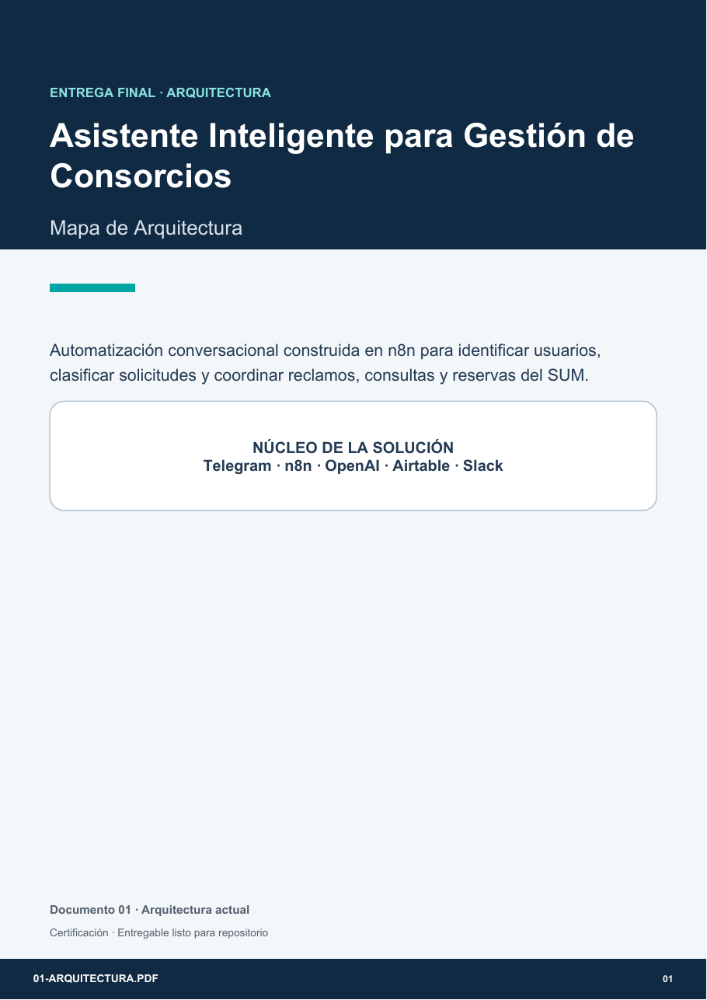
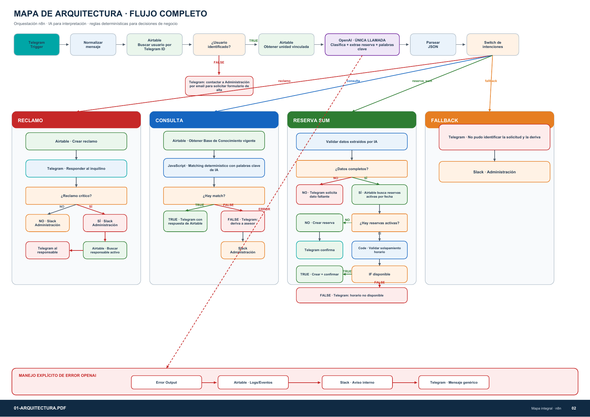
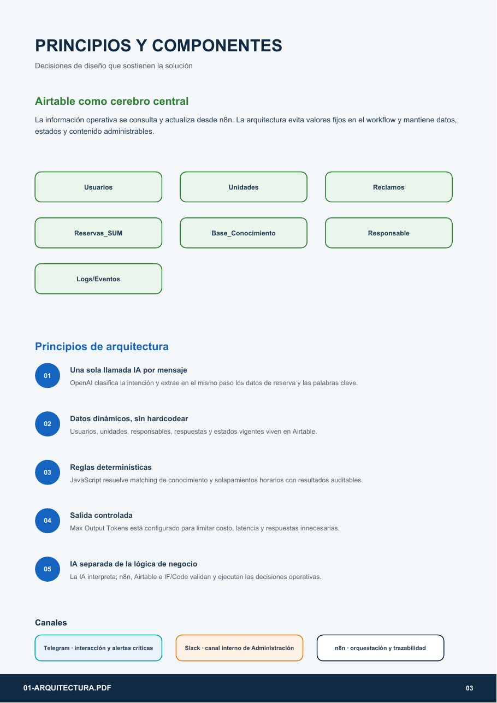
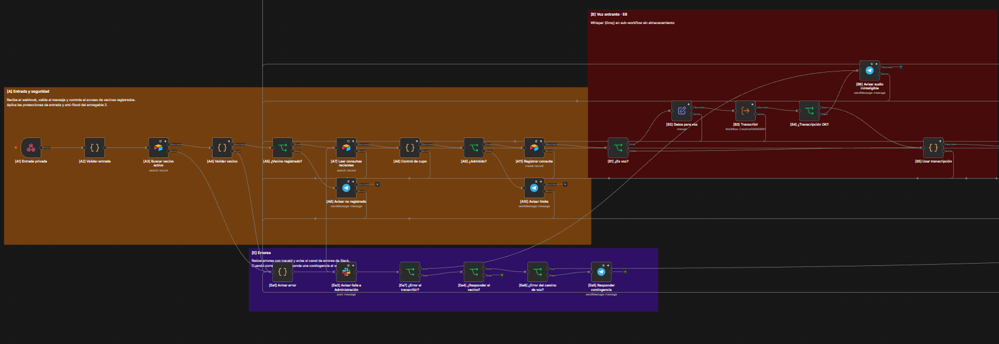
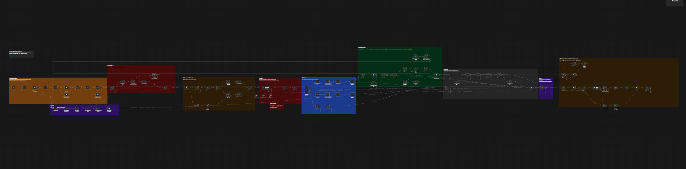

# Proyecto final

Pendiente (vence el 18/12): cobranzas con comprobantes de expensas, robustez (Error Workflow, idempotencia) y documentación completa.

## Workflows

- [consorcio_manager.json](workflows/consorcio_manager.json)
- [Mapa de arquitectura histórico](01-arquitectura.pdf): representa un diseño anterior con OpenAI.

## Capturas

-  — architecture 1 (arquitectura histórica con OpenAI).
-  — architecture 2 (arquitectura histórica con OpenAI).
-  — architecture 3 (arquitectura histórica con OpenAI).
-  — manager bloques A B E.
-  — manager completo.
